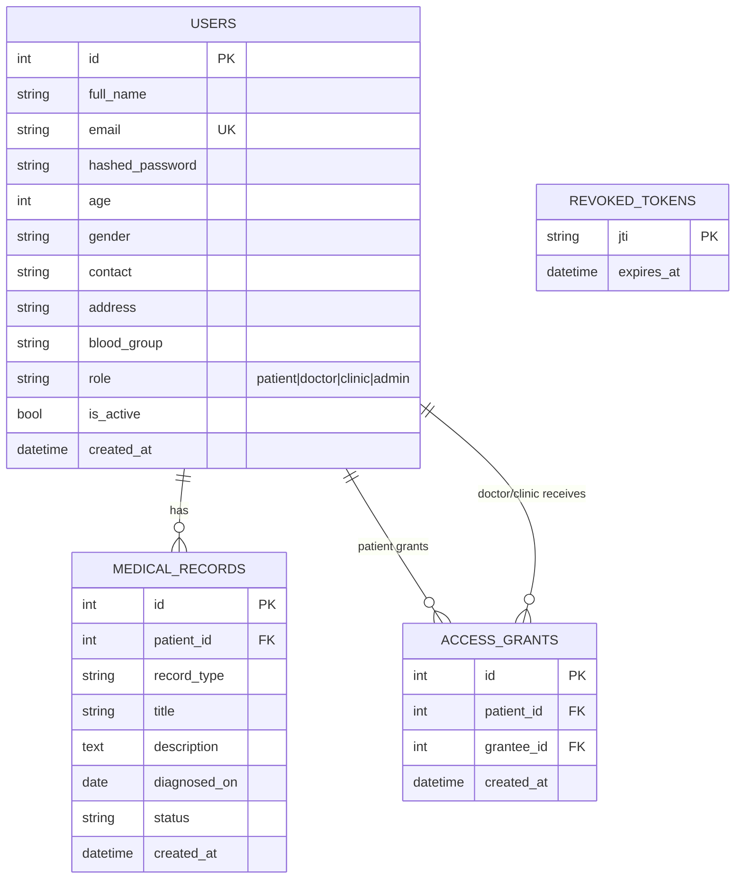

# Database Schema (Module 1)

Tables are created automatically when the backend starts.

## API summary

| Method | Endpoint | Who |
|---|---|---|
| POST | /api/auth/register | public |
| POST | /api/auth/login | public |
| POST | /api/auth/logout | logged in |
| GET / PUT | /api/users/me | logged in (own profile) |
| GET | /api/users/{id} | self, admin, or authorised doctor/clinic |
| GET / POST | /api/history | patient (own) |
| PUT / DELETE | /api/history/{id} | patient (own) |
| GET | /api/history/patient/{id} | self or authorised doctor/clinic |
| GET / POST | /api/access | patient: list / grant access |
| DELETE | /api/access/{grantee_id} | patient: revoke |
| GET | /api/access/patients | doctor/clinic |
| GET | /api/admin/users, /api/admin/stats | admin |
| PATCH | /api/admin/users/{id}/role, /status | admin |
| POST | /api/admin/access | admin |
